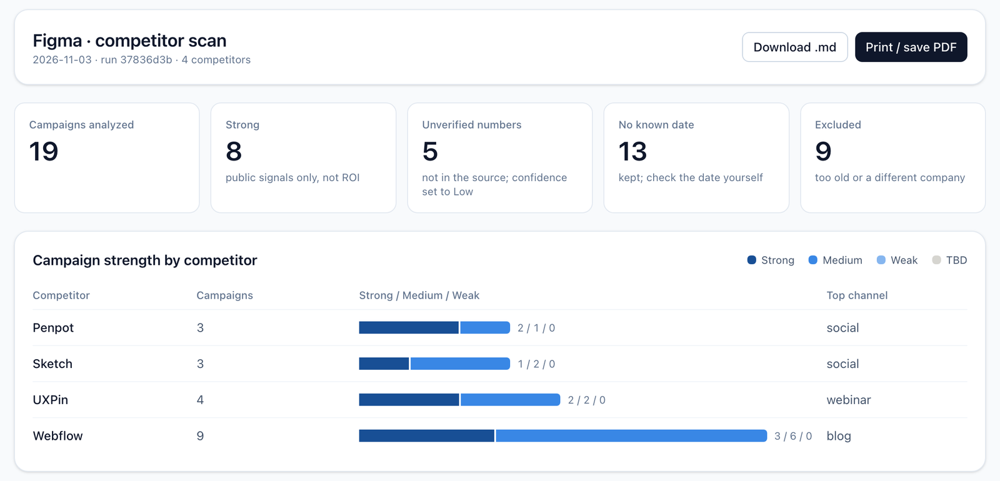
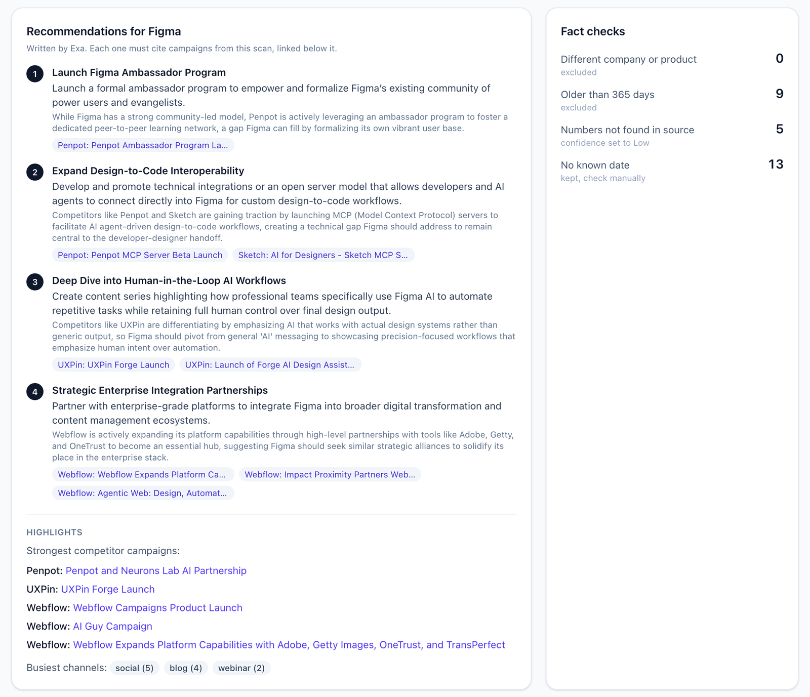

# Competitor Marketing Scan (Exa + Phoenix/Langfuse)

Enter your company → it finds your competitors → searches the web for their recent marketing
campaigns → rates each one on public signals → checks the facts → writes recommendations for you,
each linked to the campaigns behind it. Manual-run only, free-tier friendly.

Effectiveness is **public proxies only** (press, social, SEO, partnerships), never ROI or spend.
Every claim has a URL.

**Sample output:** a real scan for Figma against Penpot, Sketch, UXPin and Webflow, in
[markdown](examples/sample-report-figma.md) and as the [dashboard data](examples/sample-report-figma.json).
Page excerpts are removed from the sample; the links and ratings are as the scan produced them.

## Ways to run it
- **Web app (recommended):** FastAPI backend + React frontend. Find rivals → untick non-rivals →
  live scan → report dashboard (headline numbers, strength chart, recommendations, fact checks,
  filterable campaign table) with **Download .md** and **Print / save PDF**. Saved reports open the
  same way; reports from before the dashboard existed open as text.
- **Command line:** `python3 runner.py --company Figma` (see options below).
- **Chat agent (OpenCode):** `@marketing-researcher` uses the Exa MCP server and follows the same
  rules (see `.opencode/agents/marketing-researcher.md`). It doesn't share code with the app.

## Setup
1. `pip install -r requirements.txt`
2. `cp .env.example .env`, then add a free Exa key (no card): https://dashboard.exa.ai/api-keys → `EXA_API_KEY`
3. Web app only: `npm install --prefix web`
4. Phoenix (optional, local, free): start it and leave it running:
   `env -u PHOENIX_COLLECTOR_ENDPOINT PHOENIX_PORT=6006 PHOENIX_HOST=127.0.0.1 python3 -c "import time, phoenix as px; px.launch_app(); [time.sleep(3600) for _ in iter(int, 1)]"` → http://localhost:6006
5. Langfuse (optional): set `LANGFUSE_PUBLIC_KEY` + `LANGFUSE_SECRET_KEY` (and `LANGFUSE_OTEL_ENDPOINT` for self-host).

## Run
- **Web app:** `python3 -m uvicorn backend.main:app --port 8000 --reload`, and in a second terminal
  `npm run dev --prefix web` → http://localhost:5173. Tick **Mock mode** in Settings for a free test run.
- **Command line:**
  - `python3 runner.py --company Figma --domain figma.com --description "Collaborative design tool"`
  - `--dry-run` free mock data · `--competitors "Canva,canva.com" ...` skip discovery
  - `--no-grade` leave ratings TBD · `--no-proof` skip page fetches · `--no-self` skip scanning your own company
  - `--max-age-days 365` exclude older campaigns (0 keeps all) · `--tracer phoenix|langfuse|both|none`
  - `--synthesis template|openai|auto` · `--input inputs.yaml` read settings from yaml
- **Tests (free, no network):** `python3 -m unittest discover -s tests`

## What a scan does
1. **Discover** up to 4 direct competitors (skips discontinued products).
2. **Search** 3 queries per competitor, naming its website (e.g. "Sketch (sketch.com)") so
   look-alike companies don't creep in. Exa grades each campaign during the search: channel,
   message, signal, Strength (Strong/Medium/Weak), Confidence, and whether it's really that company.
3. **Fetch proof:** page text for the top URLs (campaigns making numeric claims first).
4. **Fact checks:**
   - campaigns older than `max_age_days` (default 365) are **excluded** (date from Exa, the page, or the URL)
   - campaigns from a **different company or product** with a similar name are **excluded**
   - numbers in a rating that don't appear in the source are **flagged** and confidence drops to Low
   - campaigns with no known date are kept and flagged
5. **Your own company:** the same searches on you, so recommendations don't repeat what you already do.
6. **Recommendations:** Exa's answer endpoint writes 3–5. Each must cite scanned competitor
   campaigns by ID; uncited ones are dropped. Mock runs show highlights instead.
7. **Report:** `reports/<date>_competitor-scan_<run>.md` plus a `.json` copy for the dashboard.
   Trace in `traces/<run>.jsonl` (and Phoenix/Langfuse if selected).

## Reading a trace
Each step is a span: `scan.run` → `exa.discover` → one `competitor` per rival (with `exa.search`,
`exa.proof`, `grade`, `verify`) → your own company → `exa.answer`. Check `results`/`graded` on
searches, `stale`/`off_topic`/`unverified_numbers` on `verify`, and `recommendations` on `exa.answer`.
Phoenix shows kind "unknown" and $0 cost for these spans; that's expected (it only auto-fills those for LLM calls).

## Costs
- Exa free tier: $20 signup credit + $10/month.
- Real scan (4 competitors + your company + recommendations) ≈ $0.06. Mock runs and tests are free.
- OpenAI rewrite only if `OPENAI_API_KEY` is set (off by default; the template keeps every check visible).
- Phoenix/Langfuse self-host: free.

## Limitations
- Recommendations know your marketing campaigns, not your product features, so they can suggest something you already offer.
- Exa's answer endpoint can draw on its own web search for context; only its citations are guaranteed to come from the scan.
- The app is light mode only.
